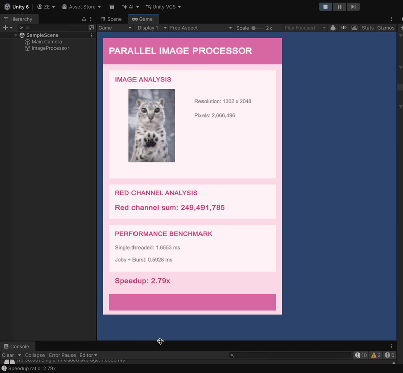

# Parallel-Processing 

Zoe Efstathiou 2423029

#### Research
I began this task by doing some research to help me understand the terminology better. Parallel computing is where a task is split into smaller parts which are then all carried out simultaneously. This has many benefits like: faster processing, improved performance and greater scalability. This task focuses on multithreading or job systems; multithreading means to use multiple threads to execute computational tasks and a job system is a framework that helps developers organise and distribute computational work across multiple threads. I will be using the Unity Job System.

#### Development

I've created a parallel image-processing system in Unity using the Unity Jobs System and Burst Compiler. Unity's burst compiler compiles compatible sections of my C# code into highly optimised native CPU code - meaning it can run faster. The program loads an image from my project's StreamingAssets folder, it then gets the RGBA values for all pixels and adds together every red value of the pixels. It runs the calculation in two seperate ways for comparison: sequentially using a loop in C# and parallel using IJobParallelFor and Burst. It then measures the time to execute the task over multiple runs and takes an average which can then be used to compare the two. Results are then desplayed on the simple UI and also in the console. In one run in the GIF above - method one is shown to take 1.5924ms and method two takes 0.3499ms. Approximately 78% less execution time. This project proves the research I had done before that parallel processing can lead to faster results. 

The project uses two scripts: ImageProcessor.cs and RedChannelJob.cs. ImageProcessor.cs loads the image, extracts the pixels and runs both types of calculation. It then measures performance using stopwatch. RedChannelJob.cs actually handles the parallel processing. It uses IJobParallelFor to divide the job into smaller chunks. Each job calculates the sum of red in its assigned selection of pixels and then stores the results in a NativeArray. 

#### AI Declaration
An AI tool (ChatGPT) was used to assist with writing code and researching technical processes. 
